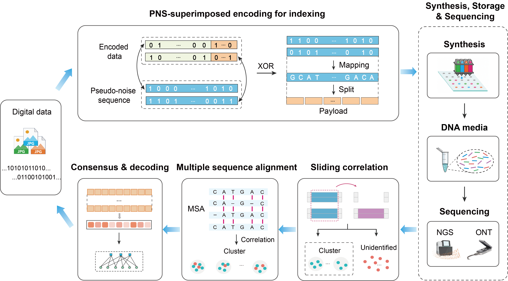

# Distributed implicit indexing for reliable oligonucleotide-based DNA data storage



## Table of Contents

- [Overview](#overview)
- [Repository Contents](#repository-contents)
- [System Requirements](#system-requirements)
- [Installation](#installation)
- [Usage](#usage)
  - [Source Data](#source-data)
  - [Fast Recovery Pipeline](#fast-recovery-pipeline)
  - [Progressive Recovery Pipeline](#progressive-recovery-pipeline)
- [License](#license)

## Overview

Synthetic DNA is a promising medium for data storage due to its high storage density and long-term stability. For DNA storage with oligo pools, digital data are distributed across unordered short DNA strands. However, reliable readout is hindered by the fragility of localized indices and the high computational cost of payload reconstruction. To address these challenges, we developed distributed implicit indexing with pseudo-noise sequence (PNS) superimposition for low-coverage readout. The proposed method enables reliable data recovery at low sequencing coverage across a wide range of error rates, providing an alternative to dedicated localized indices in oligo-based DNA storage.

This repository provides two readout pipelines designed for different error conditions:

1. **Fast recovery:** For Illumina reads with low indel rates, bit-wise consensus (BW) is used to rapidly generate probabilistic soft information for decoding, enabling fast data recovery.
2. **Progressive recovery:** For indel-prone reads, a progressive error-correction framework based on the forward–backward algorithm (FBA) is employed to achieve reliable data recovery.

The software is implemented in C/C++ and CUDA. Execution steps are organized into modular shell scripts to facilitate deployment on Linux systems. 

## Repository Contents

```text
├── fast_recovery/                            # Fast recovery pipeline
│   ├── Pool-120K/                            # Fast recovery for Pool-120K
│   │   ├── lib/                              # External library
│   │   │   └── edlib/                        # Edlib sequence-alignment library
│   │   ├── src/                              # Source code
│   │   │   ├── SubsampleFastq.c              # FASTQ read subsampling
│   │   │   ├── PrimerIdentification.c        # Primer identification and trimming
│   │   │   ├── SlidingCorrelation.cu         # GPU-accelerated sliding correlation
│   │   │   ├── MajorityVoting.c              # Bit-wise consensus
│   │   │   └── PostDecHammingDistance.c      # Post-decoding validation
│   │   ├── bin/                              # Compiled executables
│   │   ├── configure/                        # Configuration and reference files
│   │   │   ├── dvb_s2_r2_3.pchk              # LDPC parity-check matrix
│   │   │   ├── permutation64768              # Interleaving table
│   │   │   ├── primer_list.txt               # Primer sequence list
│   │   │   ├── scrambling.txt                # Scrambling sequence
│   │   │   ├── watermark.txt                 # Pseudo-noise sequence (PNS)
│   │   │   └── source_bit.txt                # Reference source bitstream
│   │   ├── data/                             # Example sequencing data
│   │   │   └── Pool-120K-NGS-assembled.fastq # Example Illumina dataset
│   │   ├── build.sh                          # Compilation script
│   │   └── recovery.sh                       # Full recovery script
│   └── Pool-64K/                             # Fast recovery for Pool-64K
│
├── progressive_recovery/                     # Progressive recovery pipeline
│   ├── lib/                                  # External library
│   │   └── edlib/                            # Edlib sequence-alignment library
│   ├── src/                                  # Source code
│   ├── bin/                                  # Compiled executables
│   ├── configure/                            # Configuration and reference files
│   │   ├── dvb_s2_r2_3.pchk                  # LDPC parity-check matrix
│   │   ├── permutation64768                  # Interleaving table
│   │   ├── primer_list.txt                   # Primer sequence list
│   │   ├── scrambling.txt                    # Scrambling sequence
│   │   ├── watermark.txt                     # Pseudo-noise sequence
│   │   └── source_bit.txt                    # Reference source bitstream
│   ├── data/                                 # Example sequencing data
│   │   └── Pool-120K-ONT-SUP.fastq           # Example Oxford Nanopore dataset
│   ├── build.sh                              # Compilation script
│   └── recovery.sh                           # Full recovery script
│
├── source_data                               # Encoding source files
├── LICENSE                                   # MIT License
└── README.md                                 # Project documentation

```


## System Requirements

### Operating Systems

The pipelines were tested on the following Linux distributions:

- **Ubuntu 18.04.6 LTS**
- **Ubuntu 20.04.6 LTS**

### Dependencies

The following tools and libraries are required:

- **GCC**: C compiler for compiling C source files.
- **G++**: C++ compiler for compiling C++ source files.
- **CUDA Toolkit**: Required for compiling and running the GPU-accelerated correlation module.
- **Edlib**: Sequence-alignment library used for primer identification and trimming. Available at https://github.com/Martinsos/edlib.
- **GNU Parallel**: Used by the shell scripts for parallel execution. It can be installed using `sudo apt-get install parallel`.
- **PEAR**: Paired-End reAd mergeR used to assemble paired-end Illumina reads. Available at https://github.com/tseemann/PEAR.
- **USEARCH**: Used for sequence clustering of reads not identified by correlation in Stage I of the progressive recovery pipeline.
- **MAFFT**: Used for multiple sequence alignment of clustered reads in Stage II of the progressive recovery pipeline.
- **LDPC codes**: LDPC encoder/decoder implementation by Radford M. Neal, used for soft-decision LDPC decoding. Available at https://github.com/radfordneal/LDPC-codes.

## Installation

Clone or download this repository, install the required dependencies, and then compile the selected pipeline using the corresponding build script.

For example, to compile the fast recovery pipeline:

```bash
cd ./fast_recovery/Pool-64K   # or ./fast_recovery/Pool-120K/
chmod +x build.sh recovery.sh
./build.sh
```

To compile the progressive recovery pipeline:

```bash
cd ./progressive_recovery/
chmod +x build.sh recovery.sh
./build.sh
```

## Usage

### Source Data

The raw sequencing data are available from the Sequence Read Archive (SRA) under BioProject accession `PRJNA1514025`.

Using the Pool-120K dataset as an example, the archive contains the following sequencing data in FASTQ format:

- `Pool-120K-NGS-R1.fastq` – Forward (R1) Illumina sequencing reads
- `Pool-120K-NGS-R2.fastq` – Reverse (R2) Illumina sequencing reads
- `Pool-120K-ONT-SUP.fastq` – Oxford Nanopore reads (SUP-basecalled)
- `Pool-120K-ONT-HAC.fastq` – Oxford Nanopore reads (HAC-basecalled)

The paired-end Illumina reads should first be assembled using PEAR:

```bash
pear -f Pool-120K-NGS-R1.fastq -r Pool-120K-NGS-R2.fastq -o Pool-120K-NGS && \
mv Pool-120K-NGS.assembled.fastq Pool-120K-NGS-assembled.fastq
```
Place `Pool-120K-NGS-assembled.fastq` in the `fast_recovery/Pool-120K/data/` directory, and place `Pool-120K-ONT-SUP.fastq` and `Pool-120K-ONT-HAC.fastq` in the `progressive_recovery/data/` directory.


### Fast Recovery Pipeline

**Command:**

```bash
cd ./fast_recovery/Pool-120K
./build.sh
./recovery.sh
```

#### [Step 1] Read Subsampling

**Inputs**
- `Pool-120K-NGS-assembled.fastq` – Assembled Illumina reads

**Outputs**
- `sub_reads.fastq` – Subsampled reads 

#### [Step 2] Primer Identification and Trimming

**Inputs**
- `sub_reads.fastq` – Subsampled reads
- `primer_list.txt` – Primer sequence list

**Outputs**
- `read_without_primer.fastq` – Payload sequences after primer trimming

#### [Step 3] Sliding Correlation

**Inputs**
- `read_without_primer.fastq` – Payload sequences after primer trimming
- `watermark.txt` – Known pseudo-noise sequence

**Outputs**
- `corr_result.txt` – Correlation results for each read, including the sequence, correlation value, offset, orientation, overlap length, PNS_ID, and read length

#### [Step 4] Bit-wise Consensus

**Inputs**
- `corr_result.txt` – Correlation results for each read

**Outputs**
- `MajorityVoting` – Consensus soft information for each codeword. Each file contains two columns representing the estimated probabilities of bit values `0` and `1` at each bit position.

#### [Step 5] Soft-decision LDPC Decoding

**Inputs**
- `MajorityVoting` – Consensus soft information for each codeword
- `source_bit.txt` – Reference source bitstream

**Outputs**
- `RecoveryBitstream` – Recovered bitstream for each codeword
- `post_decoding_error.txt` – Post-decoding error statistics
- `recovered_image.jpg` – Reconstructed image generated from the recovered bitstreams

---

### Progressive Recovery Pipeline

**Command:**

```bash
cd ./progressive_recovery/
./build.sh
./recovery.sh
```

#### Stage I

#### [Stage I-1] Read Subsampling

**Inputs**
- `Pool-120K-ONT-SUP.fastq` – Oxford Nanopore sequencing reads

**Outputs**
- `sub_reads.fastq` – Subsampled reads

#### [Stage I-2] Primer Identification and Trimming

**Inputs**
- `sub_reads.fastq` – Subsampled reads
- `primer_list.txt` – Primer sequence list

**Outputs**
- `read_without_primer.fastq` – Payload sequences after primer trimming

#### [Stage I-3] Sliding Correlation

**Inputs**
- `read_without_primer.fastq` – Payload sequences after primer trimming
- `watermark.txt` – Known pseudo-noise sequence

**Outputs**
- `corr_result.txt` – Correlation results for each read
- `Type-I_reads.txt` – Reads identified through correlation
- `lowthres_reads.fasta` – Reads not identified through correlation

#### [Stage I-4] Forward–Backward Algorithm (FBA)

**Inputs**
- `watermark.txt` – Known pseudo-noise sequence
- `Type-I_reads.txt` – Reads identified through correlation

**Outputs**
- `TypeI_symbol_probability.txt` – Indel-corrected symbol probabilities derived from Type-I reads

#### [Stage I-5] Consensus Soft Information Generation

**Inputs**
- `TypeI_symbol_probability.txt` – Indel-corrected symbol probabilities derived from Type-I reads

**Outputs**
- `SoftInfo` – Consensus soft information for each codeword. Each file contains two columns representing the estimated probabilities of bit values `0` and `1` at each bit position.

#### [Stage I-6] Soft-decision LDPC Decoding

**Inputs**
- `SoftInfo` – Consensus soft information for each codeword

**Outputs**
- `RecoveryBitstream` – Recovered bitstream for each codeword

---

#### Stage II

#### [Stage II-1] Clustering

**Inputs**
- `lowthres_reads.fasta` – Reads not identified through correlation in Stage I

**Outputs**
- `Cluster_result.uc` – Clustering results for reads not identified through correlation

#### [Stage II-2] Multiple Sequence Alignment and Consensus Generation

**Inputs**
- `lowthres_reads.fasta` – Reads not identified through correlation in Stage I
- `Cluster_result.uc` – Clustering results for reads not identified through correlation

**Outputs**
- `majority_voting.fastq` – Consensus sequences generated from clustered reads

#### [Stages II-3 to II-6] Correlation, Indel Correction, Soft Information Generation, and Decoding

**Inputs**
- `majority_voting.fastq` – Consensus sequences generated from clustered reads
- `watermark.txt` – Known pseudo-noise sequence
- `TypeI_symbol_probability.txt` – Symbol probabilities obtained in Stage I

**Outputs**
- `TypeII_symbol_probability.txt`– Symbol probabilities derived from Type-II reads
- `Symbol_Probability.txt` – Combined Type-I and Type-II symbol probabilities
- `SoftInfo` – Consensus soft information for codewords unrecovered in Stage I
- `RecoveryBitstream` – Recovered bitstreams for codewords unrecovered in Stage I
- `recovered_image.jpg` – Reconstructed image generated from the recovered bitstreams

## License

This project is licensed under the MIT License. See the [LICENSE](LICENSE) file for details.